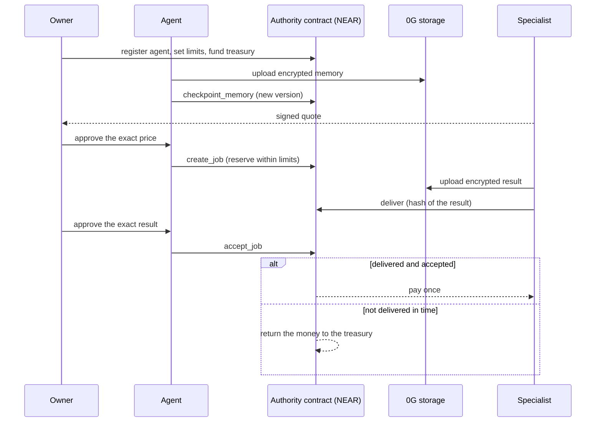
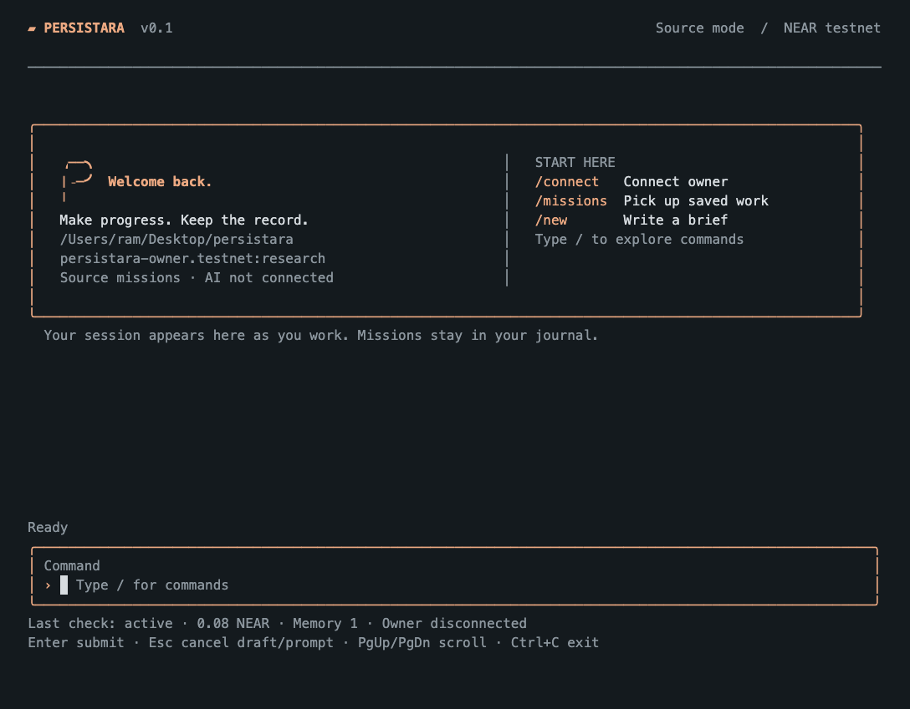
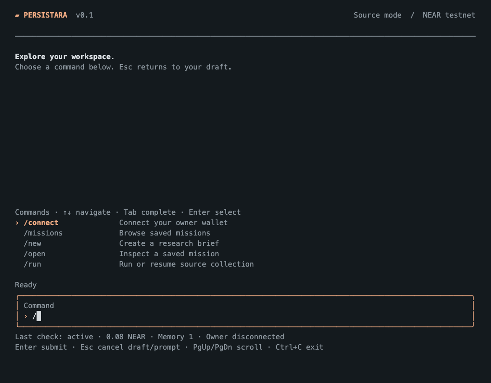
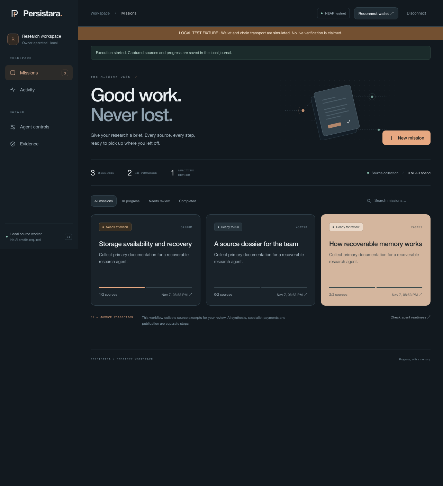
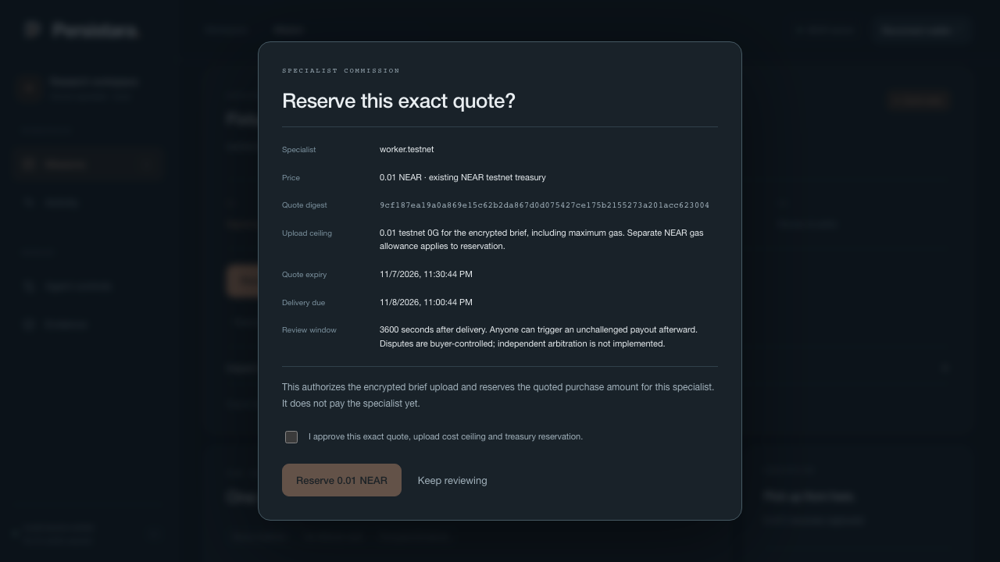

# Persistara

[](LICENSE)
[](docs/evidence/near-0g-testnet-2026-11-07.json)
[](https://testnet.nearblocks.io/address/authority.persistara-owner.testnet)
[](docs/evidence/0g-testnet-2026-11-07.json)

> A terminal workspace for an AI agent you own on NEAR: its memory is encrypted and recoverable, its work survives a crash, and a contract caps what it can spend.

**Live on NEAR testnet:** the contract [`authority.persistara-owner.testnet`](https://testnet.nearblocks.io/address/authority.persistara-owner.testnet) · encrypted storage on 0G Galileo (Turbo) · verified inference through NEAR AI

Built during the NEAR Hackathon. The first commit, `950b82c`, is dated 2026-11-06. Persistara is a successor to [Sofer](https://github.com/JemIIahh/sofer), not a copy of it: one file (the tool-interface declaration) is adapted from Sofer, seven more were read for reference only, and each is recorded with its hash in [`migration/provenance.json`](migration/provenance.json) and [`NOTICE`](NOTICE).

## What it is

You give an agent a research task and a budget. The agent remembers what you told it, gathers sources, can hire one specialist agent to do part of the work, and pays that specialist only after you review what was delivered. Every step is written down before it happens, so a crash or a lost network reply never causes a second upload or a second payment.

You run it from a terminal app. A web console exists as a companion.

## The problem

Agents today forget, repeat themselves, and hold keys they should not.

- **Memory is rented.** It lives in one vendor's database. Lose the machine or the vendor and the agent starts over.
- **Work is not durable.** A crash in the middle of a task means starting again, or worse, paying twice.
- **The agent holds the wallet.** A leaked agent key can spend everything.

Persistara answers each one:

- **Memory** is encrypted on your machine, stored on 0G, and its current version is recorded on NEAR. You can rebuild it on a clean machine from a backup file and a recovery secret.
- **Work** is journaled. Each upload, payment and model request gets an ID and a saved outcome before it is sent. After a crash the agent checks what happened instead of sending again.
- **Money** sits in a contract. The agent's key can call three methods on that one contract and nothing else, within a per-job and a daily limit you set. You can pause it on chain.

**Who holds the money:** the contract, not the agent. The owner's key is never loaded into the agent's process. The contract account has its own full-access key, and whoever holds that key can replace the contract's code ([Limits](#limits)).

## Live on NEAR testnet

| What | Where |
| --- | --- |
| Authority contract | [`authority.persistara-owner.testnet`](https://testnet.nearblocks.io/address/authority.persistara-owner.testnet) |
| Owner | [`persistara-owner.testnet`](https://testnet.nearblocks.io/address/persistara-owner.testnet) |
| Agent | `persistara-owner.testnet:research` |
| Specialist (run by us) | [`worker.persistara-owner.testnet`](https://testnet.nearblocks.io/address/worker.persistara-owner.testnet) |
| Storage | 0G Galileo testnet, chain ID 16602, Turbo |

- Testnet only, with test tokens of no value. Nothing is on mainnet.
- Every account here is ours: the owner, the agent and the specialist. Nobody outside the team has used Persistara yet.
- This deployment runs the earlier contract build, where the agent's key sits on the owner account. The newer build, where the agent is its own NEAR account (`research.<owner>`), has been deployed only to throwaway testnet accounts ([evidence](docs/evidence/e2e-testnet-2026-11-13.md)).

<details>
<summary>Recorded transactions and the deployed code's hash</summary>

| What | Transaction |
| --- | --- |
| Deployment (`DeployContract` + `new`) | [`C1jhawrZ…`](https://testnet.nearblocks.io/txns/C1jhawrZRTvMVKPMUF7fyiuN1uufyuMYvCWZCW1M7GkD) |
| Memory checkpoint (`checkpoint_memory`) | [`DGqkRsaH…`](https://testnet.nearblocks.io/txns/DGqkRsaHe2RQE69epRFT3muH98YtXUBbTyGgwmjQBcCe) |
| Job reservation (`create_job`) | [`J9oG7Ln5…`](https://testnet.nearblocks.io/txns/J9oG7Ln5zwbXc6GU3y4uMKmcQgtWA7xGiT5NH8XiYZD2) |
| Acceptance and payout (`accept_job`) | [`FBiS4u1P…`](https://testnet.nearblocks.io/txns/FBiS4u1P52zHRa5nyhU3zJVe1BmY82R3ZaM1VE16rpKA) |

- **Code hash on chain:** `GCPU1ejMZ6CPDLyT4k9GorYuXtAv5sn49jXWVzDMsKYQ`. The command under [Check the live deployment](#check-the-live-deployment) reads it back.
- **Newer build (agent as its own account):** committed at [`contracts/artifacts/`](contracts/artifacts/authority-manifest.json), code hash `4Toz9TFJg38qTg3dnGoBd8uDySRHyfhDyr6n6McXz6vq`.
- The rest is in [`docs/evidence/near-0g-testnet-2026-11-07.json`](docs/evidence/near-0g-testnet-2026-11-07.json).

</details>

## Try it on your machine (about 2 minutes)

You need `git`, Node.js 20 or newer with `corepack` (or pnpm 10.26), on macOS or Linux. No accounts, keys, funds, `.env` file or model key. pnpm downloads the pinned Node 24 itself and leaves your global Node alone.

```sh
git clone https://github.com/JemIIahh/persistara.git && cd persistara
pnpm install --frozen-lockfile
pnpm check
```

`pnpm check` typechecks, builds and runs the tests in about 25 seconds. It ends with:

```
ℹ tests 339
ℹ suites 58
ℹ pass 339
ℹ fail 0
```

Then four drills. Each one kills or removes something and shows what survives. They use local stand-ins for the chain, the storage and the model, and every one labels its output as a fixture.

**1. Recover memory on a clean process.** The original keys and index are deleted, then a new process restores from the encrypted backup.

```sh
pnpm -s memory:recover:fixture
```

```json
{
  "evidence": "LOCAL_FIXTURE_ONLY",
  "phase": "recover",
  "version": 3,
  "records": 3,
  "currentFacts": 2,
  "recoveredEpochs": [1, 2],
  "uploaderKeyUsed": false,
  "signingKeyUsed": false,
  "originalStateAvailable": false
}
```

Three records come back across two key generations, with no upload key, no signing key and none of the original state.

**2. Kill a memory write halfway.** Processes are stopped right after the upload and right after the checkpoint. New processes pick up.

```sh
pnpm -s memory:writes:fixture
```

```json
{
  "evidence": "LOCAL_FIXTURE_ONLY",
  "phase": "verify",
  "status": "committed",
  "version": 1,
  "recordUploads": 1,
  "manifestUploads": 1,
  "checkpointBroadcasts": 1,
  "originalProcessResumed": false
}
```

One upload of each kind and one checkpoint: nothing was sent twice.

**3. Crash a research mission.** The worker dies after its first source. A new process resumes.

```sh
pnpm -s missions:recover:fixture
```

```json
{"fixture":true,"workflow":"source-dossier","abruptCrashRecovered":true,"capturedSources":2,"completedReadsRepeated":0,"artifacts":1,"ownerReviews":1,"nearAiUsed":false,"publicTransactions":0}
```

Both sources are captured and the finished one is not fetched again.

**4. Lose a model reply.** A chat request is sent and its answer never arrives.

```sh
pnpm -s conversation:demo
```

The output (shortened here) shows the session refusing new messages until the owner resolves the lost request, and never resending it, because it may have been charged:

```json
{
  "fixture": true,
  "note": "Synthetic provider and data; not a real model.",
  "step2_lostOutcome": { "state": "unknown", "unknownAttempt": true, "costRecordedAsZero": false },
  "step3_sessionFencedAndNotResent": { "newMessageRefused": true, "modelRequestsSoFar": 3 },
  "step4_ownerResolvedThenContinues": { "state": "completed", "attemptStillUnknownInJournal": true, "modelRequests": 4 },
  "step5_encryptedBackupRoundTrip": { "sessions": 1, "bundleContainsPlaintext": false, "identicalAfterRestore": true }
}
```

Outputs above are from a run on 2026-11-14.

**More tests.** `pnpm test:e2e` runs 11 browser tests of the web console (first `pnpm exec playwright install chromium`). `pnpm contract:check` runs 36 Rust tests and six scenarios against the compiled contract on a local NEAR node; it needs Rust 1.96 and cargo-near 0.22 and takes about an hour.

### Check the live deployment

No key is needed. This reads the contract's code from the chain and writes it only if its hash is the recorded one:

```sh
pnpm contract:fetch --contract authority.persistara-owner.testnet \
  --expected-hash GCPU1ejMZ6CPDLyT4k9GorYuXtAv5sn49jXWVzDMsKYQ --out /tmp/persistara-authority.wasm
```

You see status `written` and the matching hash. To read a recorded transaction yourself, ask the archival RPC (older transactions leave the standard one):

```sh
curl -s https://archival-rpc.testnet.near.org -H 'Content-Type: application/json' \
  -d '{"jsonrpc":"2.0","id":1,"method":"EXPERIMENTAL_tx_status","params":{"tx_hash":"C1jhawrZRTvMVKPMUF7fyiuN1uufyuMYvCWZCW1M7GkD","sender_account_id":"persistara-owner.testnet","wait_until":"EXECUTED"}}'
```

You see the actions `DeployContract` and `FunctionCall` `new`, and a `SuccessValue` status.

## Run your own agent

Install the command without cloning (it works for everyone once the repository is public):

```sh
curl -fsSL https://raw.githubusercontent.com/JemIIahh/persistara/main/install.sh | bash
```

It builds the CLI, puts `persistara` on your PATH and creates a private workspace in `~/.persistara-workspace`. It needs no `sudo`, and `--dry-run` shows every step first. It does not create accounts or deploy a contract.

Then follow [Getting started](docs/GETTING-STARTED.md): make a testnet account, deploy your own contract and agent with `pnpm near:deploy` (a dry run by default), store your owner key in the encrypted key store with `persistara wallet add`, and open the app with `persistara`.

In the app, type `/` to see the commands. `/connect` signs you in, `/new` writes a research brief, `/run` collects its sources, `/review` records your review, `/missions` and `/open 1` reopen saved work, and `/pause` stops the agent on chain.

**AI chat is off by default.** Turning it on needs your own NEAR AI key and a deliberate setting ([how](docs/TERMINAL.md#conversation-sessions-offline-core)). The assistant can only read: it lists missions, opens one, and recalls memory. It cannot spend, sign, upload or pause.

**Docs:** [Getting started](docs/GETTING-STARTED.md) · [Install](docs/INSTALL.md) · [Deploy on testnet](docs/DEPLOY-TESTNET.md) · [Terminal](docs/TERMINAL.md) · [Architecture](docs/ARCHITECTURE.md) · [Security](docs/SECURITY.md) · [Contract](docs/CONTRACTS.md)

## How it works

1. **Own.** The owner registers an agent on the authority contract, sets a spending policy and funds its treasury. The agent gets a restricted key.
2. **Remember.** A fact is encrypted on the owner's machine, uploaded to 0G, and the new memory version is recorded on NEAR. A stale writer is rejected.
3. **Work.** A mission collects sources from approved public sites and saves each capture as it goes.
4. **Hire.** A specialist signs a quote. The owner reviews the exact price, and the contract reserves the money.
5. **Deliver.** The specialist uploads an encrypted result and records its hash on chain.
6. **Review and pay.** The owner reviews that exact result. The contract pays once. If nothing is delivered in time, the money returns to the treasury.



Four things are kept apart, and proof of one is never shown as proof of another:

- **NEAR** says who owns the agent, what it may spend, and what was paid.
- **0G** holds encrypted bytes. A NEAR record pointing at them does not prove they are still available.
- **Encryption keys** decide who can read. They are separate from the wallet keys.
- **NEAR AI** evidence shows a reply came from the attested model. It does not show the reply is correct.

## Screenshots

The terminal app, captured on 2026-11-09 against the live testnet workspace.

| Start screen | Command picker |
| --- | --- |
|  |  |

The web console, from a production build run against the fixture data of its browser tests. The missions and payments shown are test data, not testnet data.

| Mission desk | Reviewing a specialist's quote |
| --- | --- |
|  |  |

## What is verified, and what is not

**What the contract enforces**, as long as the deployed code is the committed code:

- only the owner can pause, change the policy or withdraw;
- the agent's key can reserve a job only for an approved specialist, within the per-job limit and the daily limit, and only from money already in the treasury;
- a job pays at most once, and only for the result whose hash was reviewed;
- a paused or revoked agent cannot write memory or reserve money;
- an undelivered job returns its money to the treasury after the deadline.

**What has run on testnet.**

- **Storage.** An encrypted file was uploaded to 0G, read back with a Merkle proof and decrypted, then read again by a separate process with no upload key ([evidence](docs/evidence/0g-testnet-2026-11-07.json)).
- **Memory.** A memory checkpoint was recorded on NEAR, and a clean process recovered the fact from an encrypted backup. A stale checkpoint was rejected ([evidence](docs/evidence/near-0g-testnet-2026-11-07.json)).
- **Payment.** A 0.01 NEAR job was reserved, delivered and paid once. Accepting it again paid nothing more, and a 0.03 NEAR job over the limit was rejected by the contract ([evidence](docs/evidence/near-0g-testnet-2026-11-07.json)). A second job with a real specialist delivery was also paid once ([evidence](docs/evidence/specialist-commission-2026-11-07.json)).
- **Crash recovery.** A real mission was stopped after its first source and finished by a new process without fetching that source again ([evidence](docs/evidence/native-terminal-2026-11-08.json)).
- **A stolen agent key.** Holding only the agent's key, nine attacks were tried: pause, withdraw, transfer, add a key, delete a key, deploy code, call another contract, attach NEAR, and write another owner's agent. All nine were refused ([evidence](docs/evidence/e2e-testnet-2026-11-13.md)).
- **Pause.** The owner paused the agent from the encrypted key store, and the agent's next write was refused with `ERR_AGENT_PAUSED` ([same evidence](docs/evidence/e2e-testnet-2026-11-13.md)).
- **Inference.** One NEAR AI request passed attestation, encryption, signature and tool-call checks, and one chat message in the terminal returned a verified reply that used a read-only tool ([evidence](docs/evidence/inference-spike-2026-11-11.json), [runbook](docs/INFERENCE-ACCEPTANCE.md)).

The stolen-key, pause and chat runs used throwaway testnet accounts, not the deployment in the table above.

**What a reviewer cannot rerun**, because it needs a key or funds: the owner login and pause, the 0G upload, and the paid model request. The evidence files above record each one with its transaction hashes.

**What is ours.** The owner, the agent and the specialist are all run by the team. The specialist is one curated worker that exchanges signed files with the owner; it is not an open market.

## Built with

- **Contract (Rust):** `near-sdk` 5.30.1; `near-workspaces` 0.24.0 for the tests on a local node; Rust 1.96 and `cargo-near` 0.22 for the build.
- **Chain and wallets:** `near-api-js` 7.4.0; `@hot-labs/near-connect` 0.12.0 for browser wallets.
- **Storage:** `@0gfoundation/0g-storage-ts-sdk` 1.2.13 with `ethers` 6.13.1.
- **Inference:** `@nearai/inference-sdk` 0.2.1.
- **Encryption:** Node's built-in AES-256-GCM and scrypt; `jose` 6.2.15 for the specialist's encrypted deliveries.
- **Terminal:** `ink` 8 and `react` 19.
- **Storage on disk:** Node's built-in SQLite.
- **Tooling:** TypeScript 5.9, Node's test runner, Playwright, Vite.
- **AI coding tools:** Claude Code.

## Repository

| Path | What it holds |
| --- | --- |
| `contracts/authority` | The authority contract (Rust): owners, agents, memory versions, budgets, jobs and payouts |
| `contracts/integration-tests` | Scenarios that run the compiled contract on a local NEAR node |
| `contracts/artifacts` | The committed contract builds and their hashes |
| `packages/terminal` | The terminal app: commands, reviews and the owner sign-in |
| `packages/owner` | Owner proof, the encrypted key store and its separate signer processes, the local console server |
| `packages/near` | The agent's restricted signer and its transaction journal |
| `packages/memory`, `packages/recovery` | Encrypted memory, the write journal, backups and the recovery kit |
| `packages/storage` | The 0G adapter, run in an isolated process |
| `packages/runtime` | Missions and the source collector |
| `packages/commerce` | Signed quotes, encrypted deliveries and payout checks |
| `packages/conversation`, `packages/inference` | Chat sessions, and the NEAR AI adapter with its evidence checks |
| `packages/crypto`, `packages/protocol` | The encryption envelope and shared types |
| `apps/console` | The companion web console |
| `scripts` | The CLI entry point, the deploy tool, the drills and the acceptance commands |
| `docs/evidence` | Records of the testnet runs |

[AGENTS.md](AGENTS.md) has the rules for changing the code, and [plans/README.md](plans/README.md) has the status of each piece of work.

<details>
<summary>All documentation</summary>

- [Getting started](docs/GETTING-STARTED.md) · [Install and uninstall](docs/INSTALL.md) · [Deploy on testnet](docs/DEPLOY-TESTNET.md)
- [Product](docs/PRODUCT.md) · [Architecture](docs/ARCHITECTURE.md) · [Security and failure model](docs/SECURITY.md)
- [Terminal](docs/TERMINAL.md) · [Owner console](docs/OWNER-CONSOLE.md) · [Console design](docs/CONSOLE-DESIGN.md)
- [Contract](docs/CONTRACTS.md) · [NEAR clients and transaction recovery](docs/NEAR-CLIENTS.md) · [Owner rotation](docs/OWNER-ROTATION.md)
- [Memory writes](docs/MEMORY-WRITES.md) · [Backups and recall](docs/RECOVERY.md) · [Recovery kit](docs/RECOVERY-KIT.md)
- [Missions](docs/MISSIONS.md) · [Specialist commissions](docs/COMMISSIONS.md)
- [Provider setup](docs/INTEGRATIONS.md) · [Inference acceptance](docs/INFERENCE-ACCEPTANCE.md) · [References](docs/REFERENCES.md)
- [Source selection and attribution](docs/MIGRATION.md)

</details>

## Limits

- Testnet only. No outside party has reviewed the contract, the encryption or the key store.
- The contract account's full-access key can replace the contract's code, and with new code move its balance.
- The owner decides disputes. A specialist has no protection against an owner who refuses to pay for good work.
- Rotating the agent's key is not supported when the agent is its own NEAR account. The older layout supports it.
- Recovery has been run only on the same machine, in a fresh process. A restore on a second physical device has not been done.
- The model does not plan or write the research yet. Missions collect sources; the chat assistant can only read.
- Streaming model replies failed their one live attempt and are off.
- Approving an action from a real browser wallet has not been observed; the browser tests use a stand-in wallet.
- A transaction that is dropped without a hash can stay "unknown" forever. Persistara will not resend it.
- Contract builds are not reproducible: rebuilding the source gives different bytes, so a rebuilt contract will not match a deployed hash.
- Not built: mainnet, memory search by meaning (recall is keyword search), a background service, Telegram, an open specialist market.
- Not run yet: the whole demo in one sitting, and the five-run cost and speed measurement.

[docs/SECURITY.md](docs/SECURITY.md) has the reasons, and [plans/README.md](plans/README.md) the remaining work.

## License

Apache-2.0. See [LICENSE](LICENSE). Code adapted from Sofer is credited in [`NOTICE`](NOTICE).
